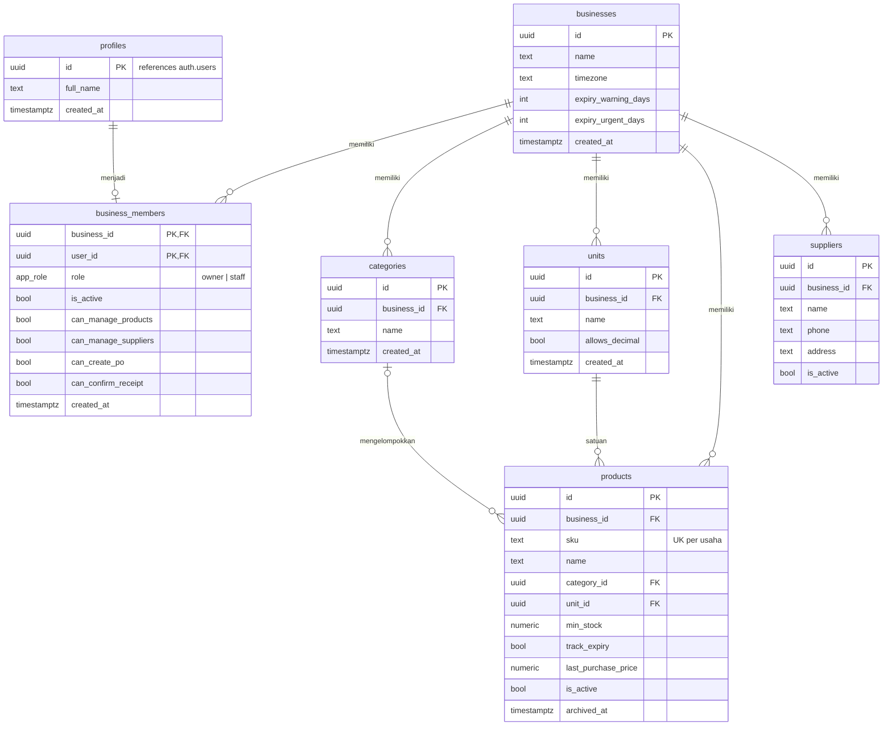
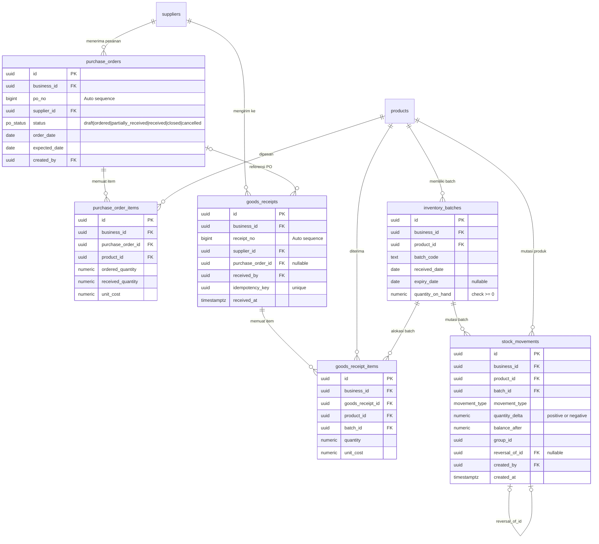
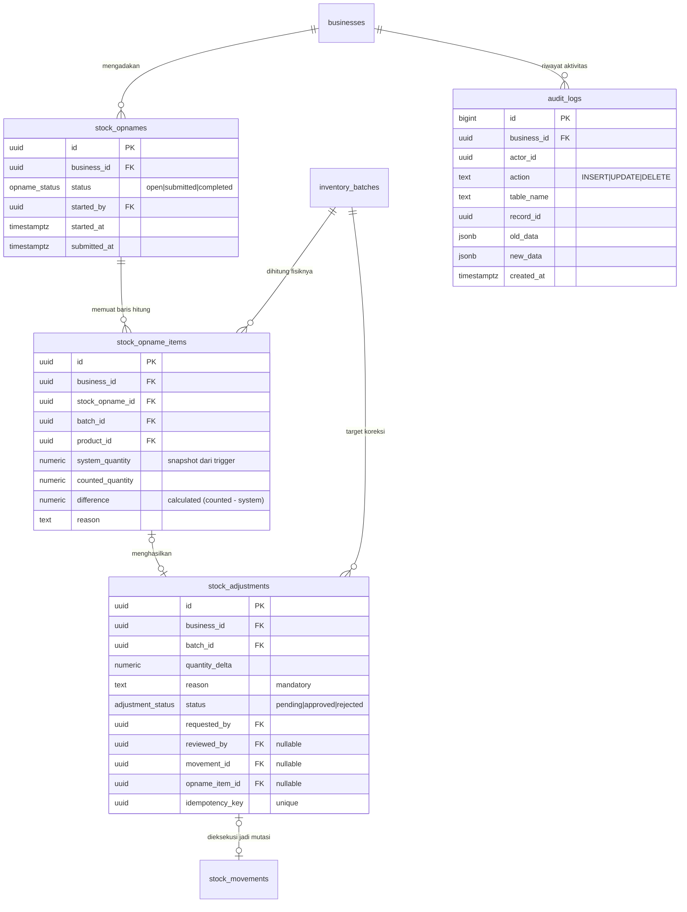
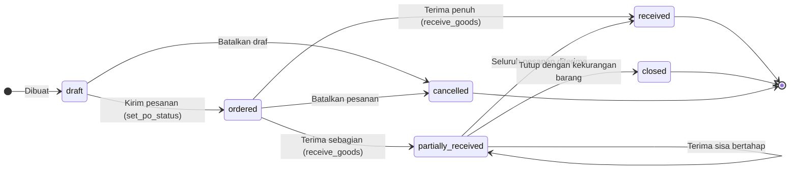
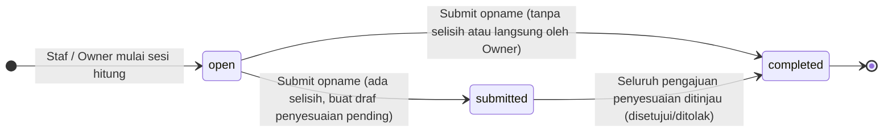

# SIMETRIS — Sistem Manajemen Inventaris Toko Sembako

> Aplikasi web manajemen persediaan komprehensif untuk toko sembako yang mendigitalisasi pencatatan manual berbasis buku catatan menjadi sistem persediaan terotomatisasi dengan pelacakan batch (FEFO), buku besar stok *append-only*, kendali akses peran bertingkat, dan jejak audit terverifikasi.

---

## Daftar Isi
- [Tentang Aplikasi](#tentang-aplikasi)
- [Tech Stack](#tech-stack)
- [Fitur Utama](#fitur-utama)
- [Entity Relationship Diagram (ERD)](#entity-relationship-diagram-erd)
  - [1. Usaha, Keanggotaan, dan Master Data](#1-usaha-keanggotaan-dan-master-data)
  - [2. Pengadaan, Batch, dan Buku Besar Stok](#2-pengadaan-batch-dan-buku-besar-stok)
  - [3. Stock Opname, Koreksi Stok, dan Jejak Audit](#3-stock-opname-koreksi-stok-dan-jejak-audit)
  - [4. Diagram Siklus Hidup Status](#4-diagram-siklus-hidup-status)
- [Keputusan Teknis Penting](#keputusan-teknis-penting)
- [Panduan Setup dan Instalasi](#panduan-setup-dan-instalasi)
  - [1. Prasyarat Sistem](#1-prasyarat-sistem)
  - [2. Kloning dan Instalasi Dependensi](#2-kloning-dan-instalasi-dependensi)
  - [3. Konfigurasi Environment Variables](#3-konfigurasi-environment-variables)
  - [4. Setup Database Supabase](#4-setup-database-supabase)
  - [5. Menjalankan Aplikasi](#5-menjalankan-aplikasi)
- [Struktur Direktori Proyek](#struktur-direktori-proyek)
- [Peran dan Matriks Akses](#peran-dan-matriks-akses)

---

## Tentang Aplikasi

**SIMETRIS (Sistem Manajemen Inventaris Toko Sembako)** dirancang khusus untuk memecahkan kendala operasional toko kelontong/sembako berskala retail hingga semi-grosir yang masih mengandalkan buku fisik. 

Masalah umum toko sembako:
1. **Kehabisan stok mendadak** karena tidak adanya peringatan dini batas stok menipis.
2. **Kerugian barang kedaluwarsa** karena barang lama tertimbun barang baru di rak/gudang.
3. **Selisih fisik vs catatan** akibat barang rusak, susut, atau pemakaian internal yang tidak terdokumentasi.
4. **Riwayat pembelian tidak terstruktur**, menyulitkan evaluasi harga pemasok dan perencanaan pesanan.
5. **Ketiadaan jejak akuntabilitas** atas mutasi stok yang dilakukan oleh staf toko.

SIMETRIS mengatasi seluruh masalah ini melalui fondasi database PostgreSQL yang ketat, aturan FEFO (*First Expired, First Out*), serta pemisahan peran operasional antara **Owner** dan **Staff**.

---

## Tech Stack

| Lapisan | Teknologi | Penjelasan |
|---|---|---|
| **Frontend Framework** | **React 19** (TypeScript) | Antarmuka pengguna modern berbasis komponen reaktif dan tipe data terjamin |
| **Build Tool & Dev Server** | **Vite 8** | Tooling build ultra-cepat dengan Hot Module Replacement (HMR) |
| **Styling** | **Tailwind CSS v4** | Sistem styling utility modern dengan palet warna terstandarisasi dan responsif |
| **Icon Library** | **Lucide React** | Ikon visual yang konsisten dan informatif untuk navigasi dan penanda status |
| **Backend & Auth** | **Supabase** | Backend-as-a-Service menyediakan PostgreSQL, Auth, Row Level Security (RLS), dan RPC |
| **Database Engine** | **PostgreSQL 16** | Basis data relasional dengan stored procedures atomik, trigger, dan view analitik |
| **Linter** | **Oxlint** | High-performance JavaScript/TypeScript linter |

---

## Fitur Utama

### 1. Dashboard Eksekutif & Operasional Real-Time
- **Ringkasan Indikator Kunci (KPI):** Menampilkan total produk aktif, peringatan stok menipis (*low stock*), barang habis (*out of stock*), batch mendekati kedaluwarsa, dan batch yang sudah kedaluwarsa.
- **Aktivitas Hari Ini:** Monitor transaksi barang masuk dan keluar yang terjadi pada tanggal berjalan (berdasarkan zona waktu lokal toko).
- **Status Tindakan Cepat:** Notifikasi Purchase Order (PO) yang sedang berjalan dan pengajuan penyesuaian stok yang menunggu verifikasi Owner.

### 2. Manajemen Data Master (Katalog Produk & Pemasok)
- **Katalog Produk Terstruktur:** SKU unik, nama barang, pengelompokan kategori, dan satuan pengukuran.
- **Dukungan Kuantitas Desimal:** Penanganan komoditas curah (seperti beras, gula, minyak dalam kg/liter dengan 3 angka di belakang koma: `numeric(14,3)`) vs barang kemasan bulat (pcs, dus).
- **Pelacakan Kedaluwarsa Selektif:** Opsi penandaan produk yang memerlukan tanggal kedaluwarsa (`track_expiry`) atau produk non-expiry.
- **Konfigurasi Stok Minimum:** Batas peringatan stok menipis yang hanya dapat diubah oleh Owner.
- **Direktori Pemasok:** Pencatatan kontak, alamat, catatan pemasok, dan integrasi riwayat harga beli terakhir per produk.

### 3. Manajemen Batch & Pemantauan Kedaluwarsa Dinamis (FEFO)
- **Pelacakan Berbasis Batch:** Setiap penerimaan barang dicatat sebagai batch tersendiri lengkap dengan tanggal terima, tanggal kedaluwarsa, dan kuantitas tersedia.
- **Status Kedaluwarsa Bertingkat (Real-Time View):**
  - <span style="color:#16a34a">**Normal**</span>: Masa kedaluwarsa masih panjang.
  - <span style="color:#d97706">**Warning**</span>: Memasuki ambang peringatan (default: ≤ 30 hari).
  - <span style="color:#ea580c">**Urgent**</span>: Memasuki ambang kritis (default: ≤ 7 hari).
  - <span style="color:#dc2626">**Expired**</span>: Sudah melewati tanggal kedaluwarsa (otomatis terisolasi dari stok layak jual).
- **Ambang Peringatan Fleksibel:** Jumlah hari peringatan dapat dikonfigurasi per usaha di halaman pengaturan.

### 4. Pencatatan Pergerakan Stok & Buku Besar Append-Only
- **Buku Besar Terperinci (*Stock Ledger*):** Setiap perpindahan fisik wajib mencatat tipe pergerakan, kuantitas mutasi, saldo setelahnya (*balance_after*), referensi, alasan, tanggal server, dan identitas pelaku.
- **Kategori Barang Masuk:** Saldo awal migrasi (`opening_balance`), penerimaan barang dari pemasok (`purchase_receipt`), dan barang masuk lainnya (`other_in` dengan alasan wajib).
- **Kategori Barang Keluar:** Penjualan (`sale`), barang rusak (`damaged`), barang kedaluwarsa (`expired`), konsumsi internal (`internal_use`), dan pengeluaran lain (`other_out` dengan alasan wajib).
- **Pengurangan FEFO Otomatis:** Saat barang keluar, sistem memprioritaskan batch dengan kedaluwarsa terdekat tanpa memerlukan input manual rumit dari staf.
- **Transaksi Pembalik (*Reversal*):** Khusus Owner, mutasi salah dapat dibalik secara audit tanpa menghapus baris riwayat aslinya.

### 5. Pengadaan & Siklus Purchase Order (PO)
- **Alur Pesanan Pembelian:** Pembuatan PO dalam status draf (`draft`), pengiriman pesanan ke pemasok (`ordered`), penerimaan sebagian (`partially_received`), penerimaan tuntas (`received`), serta penutupan/pembatalan (`closed`/`cancelled`).
- **Kalkulasi Kebutuhan Pengadaan (*Reorder Needs*):** Deteksi otomatis barang yang defisit terhadap batas minimum dikurangi barang yang sudah dalam proses pengiriman (`shortfall_qty` & `incoming_qty`).
- **Penerimaan Barang (*Goods Receipt*):** 
  - Konfirmasi penerimaan dari PO (bisa sebagian atau penuh, dengan validasi anti-over-receipt).
  - Penerimaan langsung tanpa PO (misalnya pembelian tunai spontan di pasar lokal) yang tetap mencatat pemasok, harga faktur, dan membuat batch baru.
  - Pembaruan otomatis harga beli terakhir produk (`last_purchase_price`).

### 6. Stock Opname & Penyesuaian Terkendali (*Stock Adjustment*)
- **Sesi Stock Opname Terkontrol:** Pembekuan kuantitas sistem (`system_quantity`) otomatis saat perhitungan fisik dilakukan untuk mencegah manipulasi data.
- **Perhitungan Selisih Otomatis:** Sistem mendeteksi selisih lebih (*surplus*) atau selisih kurang (*shortage*) dengan kolom alasan wajib.
- **Alur Persetujuan Dua Tingkat:** 
  - Pengajuan staf masuk antrean berstatus `pending`.
  - Owner meninjau selisih dan memutuskan untuk menyetujui (`approved`) atau menolak (`rejected`).
  - Saldo stok fisik hanya bertambah atau berkurang setelah mendapat persetujuan Owner. Pengajuan yang dibuat langsung oleh Owner langsung berlaku dan tetap tercatat.

### 7. Laporan Operasional & Ekspor CSV
- **Laporan Posisi Stok:** Saldo total, saldo layak jual, saldo kedaluwarsa, dan status ketersediaan.
- **Laporan Mutasi Persediaan:** Rekap transaksi masuk dan keluar berdasarkan rentang tanggal kalender.
- **Laporan Pembelian & Biaya:** Nilai transaksi pembelian per pemasok dan per produk.
- **Ekspor CSV Universal:** Ekspor langsung seluruh tabel laporan untuk arsip atau analisis lebih lanjut di spreadsheet (Excel/Google Sheets).

### 8. Jejak Audit & Keamanan Multi-Tenant
- **Audit Log Otomatis:** Trigger database mencatat seluruh aksi penting (`INSERT`, `UPDATE`, `DELETE`) beserta identitas akun, stempel waktu, dan komparasi payload data lama vs data baru dalam format JSONB.
- **Row Level Security (RLS) & Granular Permissions:** Pengamanan data di level database PostgreSQL memastikan data antar toko terisolasi dan hak akses staf terkunci sesuai izin yang diberikan.

---

## Entity Relationship Diagram (ERD)

Desain basis data SIMETRIS dinormalisasi secara ketat dengan integritas multi-tenant menggunakan *composite foreign keys* `(business_id, id)` dan arsitektur tabel *append-only*.

### 1. Usaha, Keanggotaan, dan Master Data

Diagram ini memodelkan identitas bisnis, profil autentikasi pengguna, hak akses granular keanggotaan, serta katalog master (kategori, satuan ukuran, produk, dan pemasok).



---

### 2. Pengadaan, Batch, dan Buku Besar Stok

Diagram ini memodelkan siklus pesanan pembelian (*Purchase Order*), penerimaan fisik barang (*Goods Receipt*), pencatatan saldo batch (*Inventory Batches*), dan buku besar mutasi stok (*Stock Movements*).



---

### 3. Stock Opname, Koreksi Stok, dan Jejak Audit

Diagram ini memodelkan proses stock opname fisik berkala, pengajuan penyesuaian (*adjustments*) yang memerlukan persetujuan Owner, serta jejak audit komprehensif.



---

### 4. Diagram Siklus Hidup Status

#### Siklus Status Purchase Order (PO)


#### Siklus Status Stock Opname & Penyesuaian


---

## Keputusan Teknis Penting

Perancangan arsitektur SIMETRIS mengadopsi prinsip keandalan tingkat perbankan (*ledger-based*) untuk menjamin tidak ada stok hilang atau saldo tidak sinkron:

### 1. Penulisan Saldo Eksklusif via RPC `SECURITY DEFINER`
Klien aplikasi web (frontend) **sama sekali tidak diberikan izin** `INSERT`, `UPDATE`, atau `DELETE` langsung pada tabel inti stok: `inventory_batches`, `stock_movements`, `goods_receipts`, dan `stock_adjustments`. Semua transaksi stok wajib dipanggil melalui Stored Procedure PostgreSQL berstatus `SECURITY DEFINER` (`record_stock_in`, `record_stock_out`, `receive_goods`, `review_stock_adjustment`, dll.). Hal ini menjamin invarian stok tidak dapat ditembus walau ada celah di sisi frontend.

### 2. Buku Besar Append-Only (*Immutable Ledger*) & Mekanisme Reversal
Tabel riwayat pergerakan stok `stock_movements` bersifat *append-only*. Trigger tingkat basis data memblokir operasi `UPDATE`, `DELETE`, dan `TRUNCATE` pada tabel ini. Apabila terjadi kekeliruan pencatatan, sistem melarang penghapusan data, melainkan menyediakan prosedur pembalik resmi (`reverse_stock_transaction`) khusus Owner yang membuat baris mutasi baru penyeimbang saldo dengan mencatat referensi baris asal (`reversal_of_id`).

### 3. Jaminan Idempotensi Transaksi & PostgreSQL Advisory Locks
Untuk mengantisipasi kegagalan jaringan, pengguna menekan tombol berulang kali, atau *race condition*, setiap transaksi stok menerima parameter `p_idempotency_key` (UUID dari klien). Prosedur database mengambil kunci *advisory transaction lock* (`pg_advisory_xact_lock`) berdasarkan hash kunci tersebut. Bila request identik tiba bersamaan atau dikirim ulang, sistem mengembalikan hasil transaksi yang telah sukses dibuat tanpa mengeksekusi mutasi ganda.

### 4. Pencegahan Oversell & Prioritas FEFO Atomik
Pada saat pengeluaran barang (`record_stock_out`), fungsi database mengunci baris batch yang bersangkutan menggunakan klausa `SELECT ... FOR UPDATE` berurutan sesuai metode FEFO (batch dengan tanggal kedaluwarsa paling awal dialokasikan terlebih dahulu). Selain itu, terdapat constraint pengaman level skema: `CHECK (quantity_on_hand >= 0)` untuk menjamin kuantitas fisik tidak akan pernah bernilai negatif.

### 5. Pemisahan Saldo Fisik vs Stok Layak Jual (*Dynamic Expiry*)
Kuantitas fisik di gudang disimpan pada `inventory_batches.quantity_on_hand`. Namun, sistem memisahkan **stok tersedia** (*available_qty*) dengan **stok kedaluwarsa** (*expired_qty*) secara dinamis melalui View `v_product_stock`. Status kedaluwarsa tidak disimpan sebagai kolom statis, melainkan dihitung secara real-time terhadap waktu toko (`private.business_today()`). Begitu barang melewati tanggal kedaluwarsa, barang tersebut otomatis lenyap dari stok layak jual tanpa memerlukan *background cron job*. Barang expired hanya dapat dikeluarkan melalui mutasi khusus bertipe `expired`.

### 6. Dukungan Angka Desimal Dinamis (`numeric(14,3)`)
Karakteristik toko sembako mencakup komoditas curah yang ditimbang (beras, terigu, telur, gula) dan barang kemasan satuan bulat (minuman sachet, sabun, makanan kaleng). SIMETRIS menggunakan tipe data presisi tinggi `numeric(14,3)` pada kolom kuantitas dan menerapkan validasi `units.allows_decimal`. Jika satuan tidak mengizinkan desimal, database secara otomatis menolak input kuantitas pecahan.

### 7. Isolasi Data Multi-Tenant dengan Composite Foreign Keys
Untuk mencegah kebocoran data antar toko pada skema bersama, setiap tabel operasional memuat kolom `business_id` dan dihubungkan menggunakan *composite foreign keys* `FOREIGN KEY (business_id, foreign_id) REFERENCES parent_table (business_id, id)`. Pendekatan ini memastikan secara matematis bahwa baris dari satu entitas toko tidak pernah dapat merujuk ke data milik toko lain di basis data.

### 8. Kemandirian Operasional Toko (Penerimaan Tanpa PO)
Pada kenyataannya di toko sembako, pemilik sering kali membeli persediaan langsung secara tunai di pasar grosir tanpa membuat surat pesanan terlebih dahulu. Oleh karena itu, relasi `goods_receipts.purchase_order_id` dirancang *nullable*. Penerimaan barang langsung tetap dapat dilakukan dengan mencatat pemasok, tanggal terima, harga beli faktur, dan batch baru.

### 9. Integritas Stempel Waktu Server & Larangan Backdating
Seluruh mutasi persediaan mencatat waktu mutasi berdasarkan waktu server PostgreSQL `now()` (`timestamptz`). Sistem sengaja tidak mendukung pencatatan transaksi bertanggal mundur (*backdated transaction*) guna menjaga keutuhan urutan kronologis buku besar saldo persediaan.

### 10. Proteksi Inisialisasi Bisnis Tunggal (`setup_business`)
Fungsi inisialisasi usaha pertama `setup_business()` diprogram dengan pengaman khusus yang hanya mengizinkan eksekusi apabila basis data masih kosong dari data usaha. Aturan ini mencegah pendaftaran akun publik liar jika pendaftaran terbuka pada Supabase Auth lupa dinonaktifkan.

---

## Panduan Setup dan Instalasi

Aplikasi SIMETRIS dapat dijalankan dengan backend **Supabase Cloud / PostgreSQL** langsung, atau dapat diuji coba seketika menggunakan penyimpanan lokal terisolasi (*Mock Local Storage Fallback*) bawaan kode.

### 1. Prasyarat Sistem
- **Node.js**: Versi `18.x`, `20.x`, atau yang lebih baru.
- **npm**: Versi `9.x` atau yang lebih baru.
- **Akun Supabase**: Proyek baru di [supabase.com](https://supabase.com) (atau PostgreSQL 16 lokal dengan ekstensi `pgcrypto`).

### 2. Kloning dan Instalasi Dependensi
```bash
# Kloning repositori
git clone https://github.com/fathurrahmanrifaldi/simetris.git

# Masuk ke direktori proyek
cd SIMETRIS

# Instal seluruh dependensi
npm install
```

### 3. Konfigurasi Environment Variables
Buat file `.env` di root direktori proyek (salin atau sesuaikan dari konfigurasi):

```env
VITE_SUPABASE_URL=https://proyek-anda.supabase.co
VITE_SUPABASE_ANON_KEY=eyJhbGciOi...kunci_anon_publik_anda
```

> **Catatan Pengujian Cepat:** Jika variabel lingkungan belum diisi atau dikosongkan, aplikasi secara otomatis beralih ke engine penyimpanan internal (`SimetrisStore`) berbasis `localStorage` browser yang telah terisi data percontohan siap pakai.

### 4. Setup Database Supabase
Jalankan file-file migrasi SQL di folder `supabase/migrations/` secara berurutan pada **SQL Editor** di dashboard Supabase Anda:

1. `0001_core_schema.sql` — Pembuatan skema, tipe enum, tabel relasional, constraint, dan indeks.
2. `0002_helpers_triggers.sql` — Fungsi utilitas zona waktu, pemicu audit logging otomatis, dan validasi stok.
3. `0003_rls_policies.sql` — Pengaktifan Row Level Security (RLS) dan kebijakan otorisasi multi-tenant.
4. `0004_stock_functions.sql` — Fungsi mutasi stok atomik `SECURITY DEFINER` (RPC).
5. `0005_views.sql` — View analitik status batch, ketersediaan produk, kebutuhan pengadaan, dan dashboard.
6. `0006_grants.sql` — Konfigurasi hak eksekusi bagi peran `authenticated` dan `anon`.

#### Inisialisasi Akun Owner Pertama
Di SQL Editor Supabase, daftarkan akun Owner dan usaha awal Anda dengan memanggil prosedur:
```sql
-- Pastikan pengguna sudah mendaftar di Supabase Auth (auth.users)
select public.setup_business(
  p_business_name        := 'Toko Berkah Jaya',
  p_owner_user_id        := 'ID_USER_DARI_AUTH_USERS', -- uuid pengguna
  p_timezone             := 'Asia/Jakarta',
  p_expiry_warning_days  := 30,
  p_expiry_urgent_days   := 7
);
```

### 5. Menjalankan Aplikasi

#### Mode Pengembangan (Development)
```bash
npm run dev
```
Aplikasi akan aktif di `http://localhost:5173`. Buka URL tersebut di browser Anda.

#### Kredensial Default (Mode Mock / Uji Coba Cepat)
Jika menggunakan penyimpanan lokal (*mock*), Anda dapat masuk langsung menggunakan kredensial bawaan:
- **Email:** `owner@simetris.test`
- **Password:** `password`
- **Peran:** Owner Toko Berkah Jaya

#### Pemeriksaan Kualitas Kode & Build Produksi
```bash
# Validasi tipe TypeScript dan build bundle produksi
npm run build

# Menjalankan linter kecepatan tinggi
npm run lint

# Menjalankan pratinjau hasil build lokal
npm run preview
```

---

## Struktur Direktori Proyek

```text
SIMETRIS/
├── .agents/                 # Panduan dan aturan otomasi kecerdasan buatan
├── public/                  # Aset statis publik
├── src/
│   ├── assets/              # Aset visual aplikasi
│   ├── components/          # Komponen UI bersama (Navbar, Sidebar, Modal, dll.)
│   ├── lib/
│   │   └── storage.ts       # Service layer data, integrasi Supabase & Mock Store
│   ├── types/
│   │   └── database.ts      # Definisi tipe TypeScript untuk entitas DB, RPC, dan view
│   ├── views/               # Tampilan halaman utama aplikasi:
│   │   ├── DashboardView.tsx       # Tinjauan metrik KPI, peringatan, dan ringkasan
│   │   ├── ProductsView.tsx        # Katalog produk, kategori, dan satuan ukuran
│   │   ├── BatchesView.tsx         # Pelacakan batch dan indikator kedaluwarsa FEFO
│   │   ├── StockMovementsView.tsx  # Form input barang masuk/keluar & buku besar
│   │   ├── PurchasingView.tsx      # Manajemen pemasok, Purchase Order (PO), & GR
│   │   ├── StockOpnameView.tsx     # Sesi hitung fisik & review penyesuaian stok
│   │   ├── ReportsView.tsx         # Laporan stok, mutasi, pembelian, & ekspor CSV
│   │   ├── AuditLogView.tsx        # Peninjau riwayat jejak audit (old vs new data)
│   │   ├── SettingsView.tsx        # Konfigurasi toko & manajemen izin anggota staf
│   │   └── LoginView.tsx           # Layar masuk pengguna
│   ├── App.tsx              # Router navigasi utama dan proteksi hak akses tampilan
│   ├── index.css            # Desain styling inti Tailwind CSS v4
│   └── main.tsx             # Entry point inisialisasi React DOM
├── supabase/
│   └── migrations/          # File migrasi SQL skema database PostgreSQL
├── DATABASE.md              # Spesifikasi teknis skema DB, kamus tabel, & skenario uji
├── PRD.md                   # Product Requirements Document
├── SRS.md                   # Software Requirements Specification
├── package.json             # Manifes dependensi dan scripts npm
├── tsconfig.json            # Konfigurasi compiler TypeScript
└── vite.config.ts           # Konfigurasi bundler Vite
```

---

## Peran dan Matriks Akses

SIMETRIS membagi pengguna ke dalam dua peran utama dengan 4 izin granular bagi staf:

| Modul / Tindakan | Owner | Staff (Dasar) | Staff (+ Izin Khusus) | Penegakan Keamanan |
|---|:---:|:---:|:---:|---|
| **Lihat Dashboard & Katalog Stok** | Ya | Ya | Ya | RLS: Anggota aktif usaha |
| **Kelola Produk, Kategori, Satuan** | Ya | Tidak | `can_manage_products` | RLS + Database Column Grants |
| **Ubah Ambang Stok Minimum** | Ya | Tidak | Tidak (Hanya Owner) | Trigger `trg_enforce_min_stock_owner` |
| **Kelola Data Pemasok** | Ya | Tidak | `can_manage_suppliers` | RLS |
| **Buat & Ubah Status Draf PO** | Ya | Tidak | `can_create_po` | RLS + RPC |
| **Konfirmasi Penerimaan Barang (GR)** | Ya | Ya | `can_confirm_receipt` | RPC `receive_goods` |
| **Catat Masuk (`other_in`) & Keluar** | Ya | Ya | Ya | RPC `record_stock_in` / `record_stock_out` |
| **Catat Saldo Awal Migrasi** | Ya | Tidak | Tidak (Hanya Owner) | RPC `record_stock_in` (`opening_balance`) |
| **Stock Opname (Hitung & Submit)** | Ya | Ya | Ya | RLS + RPC `submit_stock_opname` |
| **Ajukan Koreksi Stok Fisik** | Ya (Auto Disetujui) | Ya (Pending) | Ya | RPC `request_stock_adjustment` |
| **Setujui / Tolak Koreksi Stok** | Ya | Tidak | Tidak (Hanya Owner) | RPC `review_stock_adjustment` |
| **Balik Transaksi Stok (*Reversal*)** | Ya | Tidak | Tidak (Hanya Owner) | RPC `reverse_stock_transaction` |
| **Lihat Jejak Audit (*Audit Log*)** | Ya | Tidak | Tidak (Hanya Owner) | RLS `audit_logs` |
| **Kelola Akun Staf & Izin** | Ya | Tidak | Tidak (Hanya Owner) | RLS `business_members` |

---

## Lisensi & Kontribusi

Sistem ini dikembangkan untuk kebutuhan operasional inventaris toko sembako dan retail terpadu. Untuk pertanyaan, saran, atau pelaporan kendala, silakan buka *issue* atau ajukan *pull request* pada repositori ini.